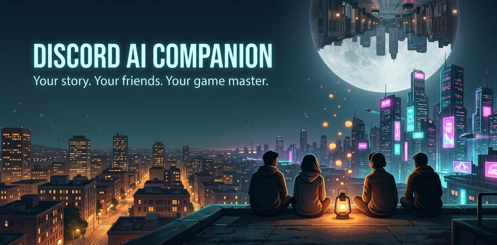
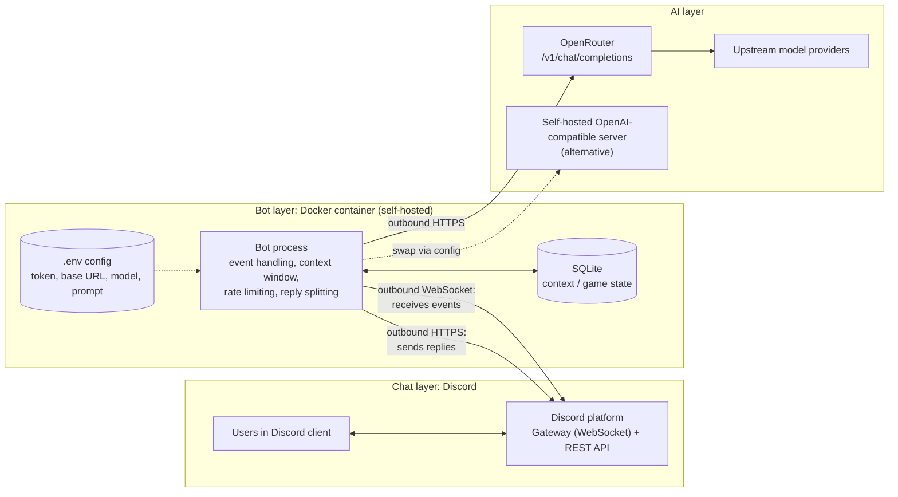
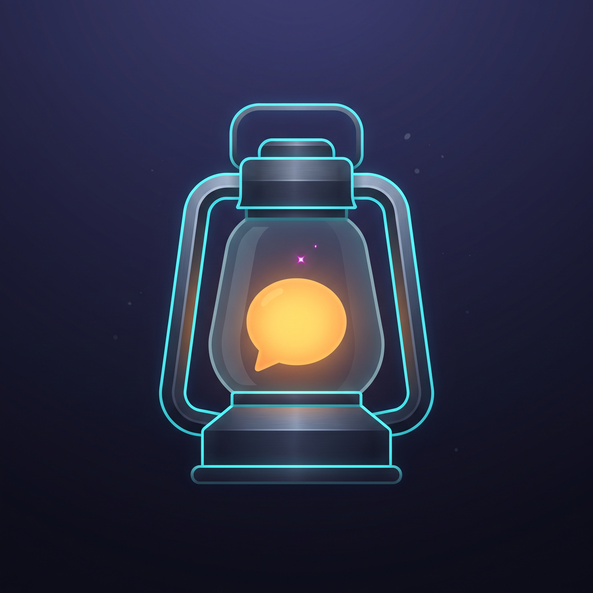

# Discord AI Companion

A private, self-hosted Discord bot that chats using any OpenAI-compatible LLM endpoint. It starts with [OpenRouter](https://openrouter.ai). The longer-term goal is a **Game Master mode**: the bot runs a shared, story-driven adventure for the people in a channel.

> **Status:** Chat MVP is live-tested and working. Game Master mode is built and tested, and awaiting its first live game. See [Roadmap](#roadmap).

## Roadmap

| Phase | Scope | Status |
|---|---|---|
| 0 | Project scaffold, config, LLM client, message splitter, Docker stack | Done |
| 1 | Chat MVP: Discord connection, `@mention` + `/ask`, SQLite context, rate limiting | Done |
| 2 | Game Master mode | Built; awaiting live test |
| Later | Public-bot features (see [Future](#future-public-bot-considerations)) | Parked |

## Architecture



**Every connection starts from the bot.** It opens a WebSocket to Discord's Gateway and receives events over it, and it sends replies through Discord's REST API. Nothing connects in to the host, so there's no port forwarding, public URL, or firewall change. The LLM is just a base URL, so OpenRouter can be swapped for any OpenAI-compatible server (Ollama, vLLM, LM Studio, ...) through config alone.

## Tech Stack

| Concern | Choice |
|---|---|
| Language | Python 3.12+ |
| Env / deps | [uv](https://docs.astral.sh/uv/) (`pyproject.toml` + `uv.lock`) |
| Discord | [discord.py](https://discordpy.readthedocs.io/) |
| LLM client | `openai` SDK with a configurable `base_url` |
| Validation / config | Pydantic + pydantic-settings |
| Storage | SQLite via `aiosqlite` |
| Tests | pytest + pytest-asyncio. The LLM and Discord are mocked, so no network is needed. |
| Lint / format | ruff |
| Deployment | Docker Compose |

Python was chosen because most of the work is prompt assembly, structured-output validation, and LLM plumbing, and Python's ecosystem is strongest there.

## Getting Started

### 1. Create the Discord application

A private bot needs no approval or review. A "bot" is just an *application* you create yourself.

1. In the [Discord Developer Portal](https://discord.com/developers/applications), click **New Application** and give it a name.
2. On the **Bot** tab:
   - Reset and copy the **token**. It goes in `.env` and is never committed.
   - Turn **Public Bot** off so only the owner can invite it. If you get *"Private application cannot have a default authorization link"*, first go to **Installation**, set **Install Link** to **None**, save, then try again.
   - Turn **Message Content Intent** on. Game Master mode needs it to read in-character chat in game threads; the bot ignores message text everywhere else. Without it, the bot refuses to start and logs how to fix it.
3. Under **OAuth2 → URL Generator**:
   - Scopes: `bot`, `applications.commands`
   - Bot permissions: View Channels, Send Messages, Send Messages in Threads, **Create Public Threads**, Read Message History
   - Already invited the bot? Open the new URL again and authorize. That updates the bot's permissions in place.
4. Open the generated URL and add the bot to your server. You need Manage Server permission there.

Discord verification only applies once a bot reaches **100 servers**.

**Slash-command sync:** with `DISCORD_GUILD_ID` set, commands appear in that server instantly. Commands synced *globally* by an earlier run without it stay registered, so if `/ask` shows up twice, that's the cause. If sync fails (wrong server ID, or the bot was invited without the `applications.commands` scope), the bot logs the error and keeps running; @mentions still work.

### 2. Configure

```sh
cp .env.example .env
```

| Variable | Required | Default | Purpose |
|---|---|---|---|
| `DISCORD_TOKEN` | yes | | Bot token |
| `DISCORD_GUILD_ID` | | | Server ID for instant slash-command sync. If unset, commands sync globally. |
| `LLM_API_KEY` | yes | | API key for the LLM endpoint |
| `LLM_MODEL` | yes | | Model ID, e.g. an OpenRouter model slug |
| `LLM_BASE_URL` | | `https://openrouter.ai/api/v1` | Any OpenAI-compatible endpoint |
| `LLM_TIMEOUT_SECONDS` | | `60` | Per-request timeout |
| `LLM_MAX_RETRIES` | | `1` | Retries on transient errors |
| `LLM_MAX_TOKENS` | | provider default | Cap on reply length. Replies cut off at the cap are marked *(reply truncated)*. Game setup returns a lot of JSON, so leave this unset or keep it at 3000 or more. |
| `SYSTEM_PROMPT` | | friendly assistant | Bot persona and instructions |
| `CONTEXT_MESSAGES` | | `20` | Recent messages kept and sent as context |
| `CONTEXT_MAX_CHARS` | | `24000` | Character budget for context, so history can't outgrow the model's context window |
| `RATE_LIMIT_PER_MINUTE` | | `5` | Per-user request limit |
| `GLOBAL_RATE_LIMIT_PER_MINUTE` | | `20` | Limit across all users, to protect the provider account's quota |
| `GAME_ROUND_HOURS` | | `24` | Round deadline in Game Master mode (reminder at the halfway point) |
| `GAME_TARGET_ROUNDS` | | `12` | Target adventure length in rounds (hard stop 2 rounds later) |
| `DATABASE_PATH` | | `data/companion.db` (`/data/companion.db` in Docker) | Shared SQLite file location |

Secrets are typed as `SecretStr`, so they're masked in logs and error output. If required values are missing, startup fails fast and names the missing variables, never their values.

### Running on different terminals or devices

Different terminals and devices can coordinate only when they use the **same shared database**.
Set `DATABASE_PATH` to the same mounted network path on every machine, for example:

```env
DATABASE_PATH=\\server\discord-ai-companion\companion.db
```

Do not use separate local `data/companion.db` files: those files do not synchronize history,
players, rounds, or AI identities. The application stores Discord message claims and short-lived
game leases in the database, so multiple instances can safely receive the same Discord events
without resolving a round twice. The shared storage must support concurrent writes; a local
LAN/NAS mount is preferable to a high-latency or unreliable cross-region file share. For
different regions, run one shared database service or a single shared data host rather than
opening a SQLite file directly over the public internet.

### Running multiple Discord Bots

The same source tree can run up to ten independent Discord Bot applications. Each application
needs its own Bot token; the token is not a Discord account name. Keep the existing unnumbered
variables for the first Bot, then add numbered profiles for the second through tenth:

```env
DISCORD_TOKEN=first-bot-token
DISCORD_GUILD_ID=first-server-id
LLM_BASE_URL=https://generativelanguage.googleapis.com/v1beta/openai/
LLM_API_KEY=first-gemini-key
LLM_MODEL=gemini-2.5-flash

DISCORD_TOKEN_2=second-bot-token
DISCORD_GUILD_ID_2=second-server-id
LLM_BASE_URL_2=https://generativelanguage.googleapis.com/v1beta/openai/
LLM_API_KEY_2=second-gemini-key
LLM_MODEL_2=gemini-2.5-pro
```

Add `_3` through `_10` in the same way when needed. `LLM_BASE_URL_N` is optional and falls back
to the unnumbered URL. `DISCORD_GUILD_ID_N` is also optional and falls back to the unnumbered
server ID. When more than one complete profile is configured, run:

```powershell
python -m companion
```

The terminal asks how many profiles to start. Enter an integer from `1` to the highest
contiguous profile configured. All selected Bots run concurrently in this one terminal. All
selected Bots register the same `/game` and `/act` commands and can create or host a game.
The first Bot is the shared event coordinator: it consumes thread messages and runs deadline
checks use a short shared database lease, while every Bot can execute game commands against the
shared database. Event claims and game leases avoid duplicate messages and duplicate round
resolution while keeping the command set equal, even when profiles run in separate terminals.

### AI players in a shared adventure

Every configured Bot has the same `/game`, `/act`, `/ask`, `/reset`, and `/help` commands.
The first Bot is the GM/event coordinator; the other Bots can join as AI-controlled player
characters. A human must explicitly invite a Bot in the game thread:

```text
@Evil 加入游戏 角色：盗贼，擅长潜行
@Evil act
```

The invited Bot uses its numbered persona (and an optional requested `角色：...` or `role: ...`),
generates one action of at most 50 words, and sends
the controlled `/act ai ...` protocol message for the coordinator to resolve. AI messages do not
invite themselves, trigger another AI, or start an automatic loop. The default personalities
for profiles 1-10 are in [`src/companion/game/ai_roles.py`](src/companion/game/ai_roles.py);
edit that file to customize each Bot's identity, personality, and behavior. Only a human
message that explicitly mentions the target Bot can invite it or request its action.

### 3. Run

```sh
docker compose up -d --build
docker compose logs -f
```

It runs as a named container (`discord-ai-companion`) and is portable to any Docker host.

Container hardening:
- **Non-root user:** the bot runs as uid 10001.
- **Read-only filesystem:** the only writable paths are `/data` (a named volume holding SQLite) and `/tmp`.
- **Locked down:** all Linux capabilities are dropped and `no-new-privileges` is set.
- **Resource caps:** memory is limited to 256 MB and processes to 100.
- **No published ports:** all traffic is outbound.
- **Secrets stay out of the image:** they're injected at runtime from `.env` and excluded from the build context.

## Development

```sh
uv sync                  # create .venv with all deps
uv run pytest            # run tests
uv run ruff check .      # lint
uv run ruff format .     # format
```

Rules:
- Every change ships with tests.
- Nothing is committed until the full test suite and lint pass.
- Secrets live only in `.env`, which git ignores.

Layout:

```
src/companion/
  config.py      # settings from env, validated, secrets masked
  db.py          # shared SQLite connection and schema
  llm.py         # OpenAI-compatible chat client + error mapping
  structured.py  # validated JSON from the LLM, with corrective retries
  store.py       # chat context per channel/thread
  ratelimit.py   # sliding-window rate limiter
  chat.py        # chat logic (prompt building, errors), Discord-free
  bot.py         # Discord client: @mention, /ask, /reset, message routing
  splitter.py    # split replies to Discord's 2000-char limit, code-block aware
  __main__.py    # entry point (python -m companion)
  game/
    store.py     # games, players, round posts, story bible
    dice.py      # 2d6 with success / partial / failure
    schemas.py   # JSON shapes the GM must return
    prompts.py   # the GM's prompts (review these, they shape behaviour)
    engine.py    # game lifecycle, rounds, deadlines; Discord-free
    commands.py  # /game and /act commands, thread chat, deadline delivery
tests/           # mirrors src; LLM and Discord are faked
```

## Phase 1: Chat MVP

**Goals**
- A private bot for our own server(s).
- Useful in conversation: it answers when asked and keeps enough context to follow a discussion.
- Provider-agnostic: switching LLMs is a config change.

**Non-goals for now**
- Being a public or verified bot, or billing.
- Ambient participation, where the bot joins conversations without being addressed.
- Long-term per-user memory, tool use or agent actions, and per-server configuration.

**Scope**
- **Triggers:**
  - `@mention` replies in the same channel or thread.
  - Replying to one of the bot's messages counts as a mention, as long as the reply ping is left on.
  - `/ask <prompt>` defers the interaction (Discord requires an acknowledgment within 3 seconds), then posts the answer as a follow-up.
  - `/help` privately lists every command and explains how to play. It's generated from the registered commands, so it can't go stale. The chat prompt only says "point people to `/help`" and steers RPG requests to `/game new`, which keeps prompts small.
  - `/reset` clears the bot's memory of the current channel or thread. By default it needs Manage Messages; server admins can change that under Server Settings → Integrations.
  - Not triggers: replies with the ping turned off, @mentions of the bot's *role*, system messages, webhooks, and other bots.
- **Context:** a rolling window of **bot-directed messages only**, per channel or thread: prompts sent to the bot and its replies. Other channel chatter is never used, even though the Message Content intent is on for Game Master mode. Each prompt is stored with the speaker's display name so the bot can tell people apart, and its formatting (newlines, code) is preserved. History is capped by message count and a character budget, and always starts on a user turn. Requests in the same channel are handled one at a time, so each sees the previous exchange. Context lives in SQLite and survives restarts. An exchange is only stored if the LLM answered.
- **Server-only:** DMs are ignored and slash commands are guild-only. This stops people outside the server from using up the API quota.
- **Mention safety:** all bot messages are sent with mentions disabled, so LLM output can never ping `@everyone`, roles, or users.
- **Output:** replies over 2000 characters are split at paragraph, line, or word boundaries. Code blocks are closed and reopened across chunks. No streaming, because repeatedly editing a message hits Discord rate limits.
- **Limits:** per-user and global rate limits. A rate-limited user is told once per window, and further messages in that window are silently ignored, so spam doesn't turn into bot spam.
- **Errors:** friendly messages when the LLM is rate-limited, unavailable, times out, or returns something malformed (e.g. a wrong `LLM_BASE_URL`). The provider's error text is logged to help diagnosis. If the user deleted their message while waiting, the answer is still posted.

## Phase 2: Game Master Mode

The bot runs a **shared, story-first adventure** for the people in a channel. Everyone experiences a story together, rather than playing a hack-and-slash game with detailed stat tracking.

### Design principles
- **Narrative over mechanics.** Rules-light, with no detailed HP, spell points, or loot tracking.
- **Bounded adventures.** Each game has a beginning, middle, and end, and there's no character progression across campaigns.
- **The database is canon.** Story continuity lives in structured storage, not in the chat transcript.
- **Code adjudicates, the LLM narrates.** Dice, turn handling, and state validation are code. Description, NPCs, and consequences come from the LLM.

### Anti-drift architecture
Long AI roleplay usually degrades for four reasons: the transcript is the only memory, summaries lose specifics, nothing is canonical, and the story has no destination. Each has a countermeasure:

| Problem | Countermeasure |
|---|---|
| No destination, endless wandering | **Hidden adventure outline** generated at game start: premise, 3–4 acts, key NPCs and secrets, possible endings. Players don't see it. |
| Nothing is canonical | **Story bible** in the DB: characters, NPCs, places, significant items, established facts, open threads. |
| Transcript grows until details fade | **Prompt rebuilt fresh each round** from the outline, current act, bible, rolling summary, and the last few rounds only. |
| New facts get lost | **Canon extraction:** each round the LLM returns new or changed facts as JSON, which code validates and stores. |
| Drift goes uncorrected | **Player tools:** `/game recap` and `/game canon` let the table spot and call out contradictions in character. |

This greatly reduces drift but cannot eliminate it. Model choice matters, especially for following the facts given in the prompt and for producing reliable JSON.

### Structured output (prerequisite)
Game state updates come back from the LLM as JSON, so parsing, validating, and retrying JSON responses will be a first-class, tested component. We won't rely on native tool calling, since support is inconsistent across models.

### How a game flows
Games are **asynchronous**, played over days in a dedicated thread.

1. **`/game new genre:<text>`** in any regular channel. The bot opens a thread for the game, and the person who ran it is the **host**. The genre is free text, e.g. "cyberpunk heist" or "modern day, but the town's clocks run backwards". Leave it blank and the GM pitches three premises; the host chooses with **`/game pick`**.
2. **`/game join concept:<optional hint>`** in the thread. The GM creates each character, using the player's hint if given ("burned-out ex-cop who owes a fixer money"). **Late joiners** are welcome: their character is created on the spot and written into the story.
3. **`/game begin`** (host only). The GM writes a hidden outline, posts character cards, and opens round 1.
4. **Each round**, players post freely **in character** in the thread over the day. Messages starting with `((` or `//` are out-of-character and ignored. When a player is done, they use **`/act`** (optionally with a final note).
5. The round **resolves** when every player has acted or the **24-hour deadline** passes. Players who didn't act follow the group's lead. At the halfway point, the bot pings only the players who haven't acted yet.
6. The adventure targets **about 12 rounds**. The GM steers toward an ending, posts an epilogue, and the game closes.

AI Discord bots can participate as players without creating a second game controller. A human
must mention the bot in the game thread and explicitly say that it should join; ordinary bot
messages are ignored until that invitation succeeds. Once invited, its messages are recorded as
in-character posts. An AI player can submit one action per round by sending the text
`/act ai <action>` (this is an internal message protocol, not a simulated Discord interaction);
the action is limited to about 50 words. AI messages never automatically trigger another AI
response, so the GM bot remains the only component that resolves rounds.

Other commands: **`/game status`** (who's still to act, and the deadline), **`/game recap`** (story so far), **`/game canon`** (established facts), **`/game end`** (host or moderator).

### Light mechanics
- **Rolls:** each round the code rolls **2d6** for every player. **10+** is a success, **7–9** a partial success (with a cost or complication), and **6 or less** a failure that still moves the story forward.
- **When rolls count:** the LLM applies a player's roll only when their action was risky. It reports which rolls it used, and those are shown publicly (e.g. `🎲 Sam (Vex): partial success (8)`), so the dice are honest and visible.
- **No HP or stats:** narrative conditions ("wounded", "lost the map", "owes the smugglers") take their place.
- **Tone:** the GM keeps content fairly tame (roughly PG-13). There is no per-game setting.

### Reliability
- **One LLM call per round** for resolution, which returns narration, canon updates, an updated summary, and the current act as validated JSON.
- **Deadlines** are stored in SQLite, so a restart doesn't lose them. A background check runs every minute.
- **LLM failures:** if the LLM fails during resolution, the round stays open and is retried every 10 minutes.
- **Prompt injection:** player text is passed to the LLM as clearly delimited, untrusted in-character content.

### Discord requirements
- **Message Content intent:** must be enabled in the Developer Portal (Bot → Privileged Gateway Intents) so the GM can read in-character chat. The code ignores message content everywhere except active game threads, so **only game-thread chat is sent to the LLM provider**. Tell players this.
- **Create Public Threads:** the bot needs this permission, in addition to the chat permissions.
- **Thread archiving:** game threads use Discord's longest auto-archive window (1 week), and a bot post re-opens an archived thread.

## AI Provider and Privacy

We use **OpenRouter**, either with free models or with cheap paid ones. Paid models are noticeably more reliable for Game Master mode's narration and JSON. The bot depends only on basic `/v1/chat/completions`.

Caveats with free models (check OpenRouter's current docs, since limits change):
- **Tight request limits,** both per minute and per day. The daily cap is higher once credits have been purchased.
- **Models come and go,** so the configured model may disappear.
- **Prompt logging:** some free providers may log prompts or train on them.

**Privacy:** messages the bot uses as context are sent to the configured LLM provider. In chat mode that means only bot-directed messages; in Game Master mode it also includes everything posted in active game threads. Server members should be told this, for example with a pinned note in the channels where the bot is active.

## Open Questions

**Chat MVP**
- [x] **Context contents:** bot-directed messages only.
- [ ] **Persona:** one fixed system prompt, or a configurable personality?
- [ ] **Channels:** active everywhere, or only in an allowlist?

**Game Master mode**: all resolved (see [How a game flows](#how-a-game-flows)): async over days, a thread per game, GM-made characters from optional player hints, player-chosen genre or GM pitches, about 12 rounds, and in-character chat read from the thread.

## Future: Public-Bot Considerations

These are parked until the private bot proves useful:
- Per-server config (endpoint, model, prompt) and admin commands
- Personas and long-term memory outside of games
- Tool use, with prompt-injection hardening
- Usage quotas, paywall, and cost controls
- Discord verification (required at 100+ servers) and approval for privileged intents
- Market research: competing AI and GM bots, and demand among Discord users

## License

[MIT](LICENSE)

---

<p align="center">
  
</p>
